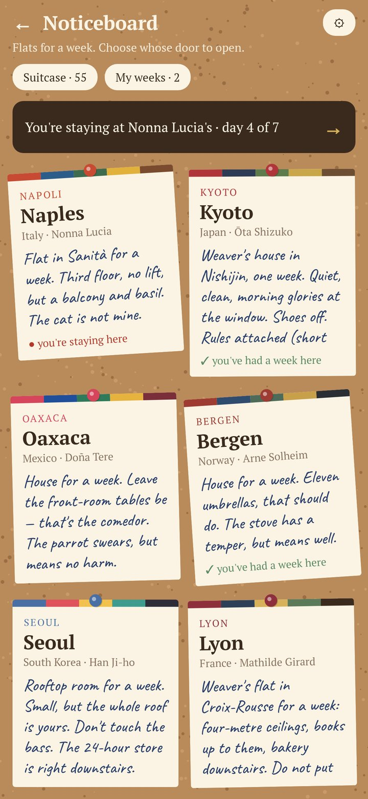
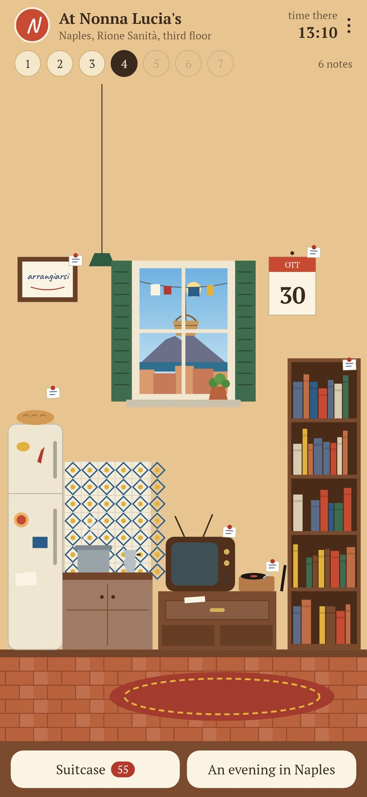
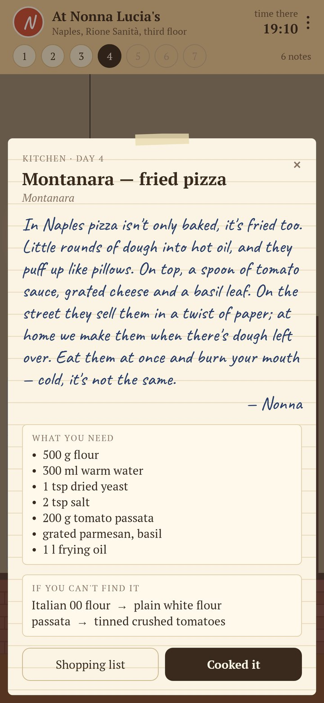
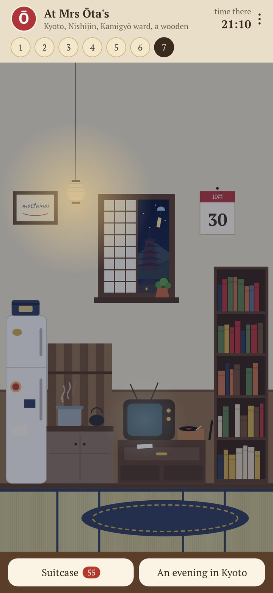

<div align="center">

# Under the Mat

### A week in someone's flat abroad, without leaving home.

*The key is under the mat. A host in Naples, Kyoto, Oaxaca or Bergen is away for a week, and has left notes in every corner of the flat: what to cook tonight, the film everybody there knows by heart, the record to put on, the book from their school syllabus, a house rule, a letter in the drawer. One new day of notes each morning. Free, no ads, no account.*

[](https://github.com/bigdevwhale/undermat/actions/workflows/android.yml)


[](LICENSE)

**English** · [Русский](README.ru.md) · [Changelog](CHANGELOG.md)

   

</div>

---

## How it works

1. **The noticeboard.** Twelve flats are offered for a week: Naples, Kyoto, Oaxaca, Bergen, Seoul, Lyon, Tbilisi, Kolkata, Salvador, Lisbon, Galway, Istanbul. Each belongs to one person: a Neapolitan grandmother, a retired teacher in a Kyoto townhouse, a ferry engineer in Bergen, a young designer in a Seoul rooftop room…
2. **The key under the mat.** Lift the mat, read the note under it, open the door.
3. **Notes in every corner.** The kitchen has tonight's recipe, with what to use if your shop doesn't sell it. The television has a film everyone there knows, and why. The record player, the bookshelf, magnets on the fridge (a true fact and a word of the day, said aloud by the phone's own voice), a house rule, a framed word that doesn't translate, and a letter in the drawer: a week of letters with a story of their own.
4. **What every local knows, not what tourists know.** The film shown every New Year, the song at every wedding, the book from school, the dish a grandmother makes.
5. **A real window.** The view is the host's city, at the host's local time, under the real sunrise, sunset and weather there.
6. **Neighbours.** On days 2, 4 and 6 somebody drops by: a neighbour with a pastry, a basket lowered on a rope past the window, a boy with a raffle ticket, and a custom behind each.
7. **The suitcase.** Cook, watch, listen, read: every one is a luggage sticker in the city's colours. On day seven you leave the host something of your own country, put the key back under the mat, and the week stays in "My weeks" to read again.
8. **An evening in Lisbon.** One card for two or for friends: the dish, the record while it cooks, the film after dinner, the toast and three things to talk about.

The hosts are invented; every film, record, book, dish and holiday is real.

## Privacy

No account, no ads, no analytics. Everything stays on the phone. The only network request is the weather outside the host's window: the city's coordinates go to Open-Meteo (or to MET Norway when Open-Meteo can't be reached), nothing else. "Where to find" opens a search in your browser or music app; the app itself plays and shows nothing.

## Building

```bash
./gradlew testDebugUnitTest assembleDebug        # app.undermat.dev, next to a real install
./gradlew assembleDebug -Pdemo                   # app.undermat.demo, four days into a week in Naples
./gradlew testDebugUnitTest -Prender --tests '*RenderArt*'   # screens to app/build/art
python tools/check_hosts.py                      # checks every host file against tools/CONTENT.md
```

Kotlin, Jetpack Compose, DataStore, WorkManager. Each host is one JSON file in `app/src/main/assets/hosts` (both languages, seven days); `tools/CONTENT.md` is the brief for writing one. The flats are drawn in code (`ui/flat/Interior.kt`): one room, and each city's floor, tiles, window, view, lamp and one object that could only be there.

## License

[MIT](LICENSE). Fonts: PT Serif and Caveat (SIL OFL). Weather: [Open-Meteo.com](https://open-meteo.com) and [MET Norway](https://api.met.no) (CC BY 4.0).
