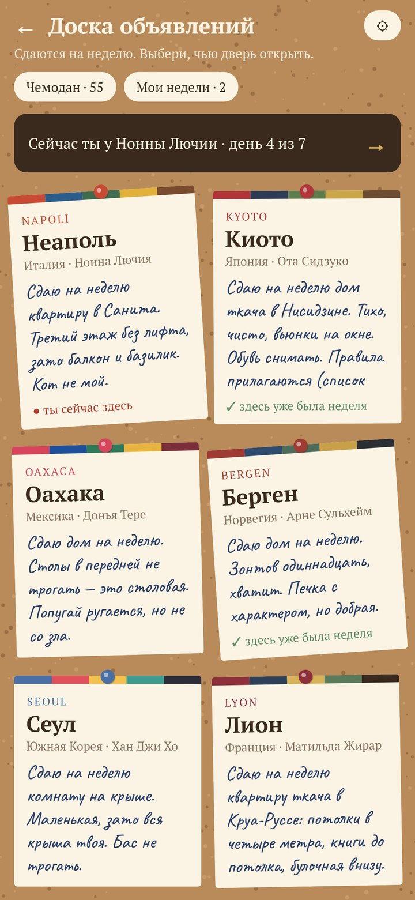
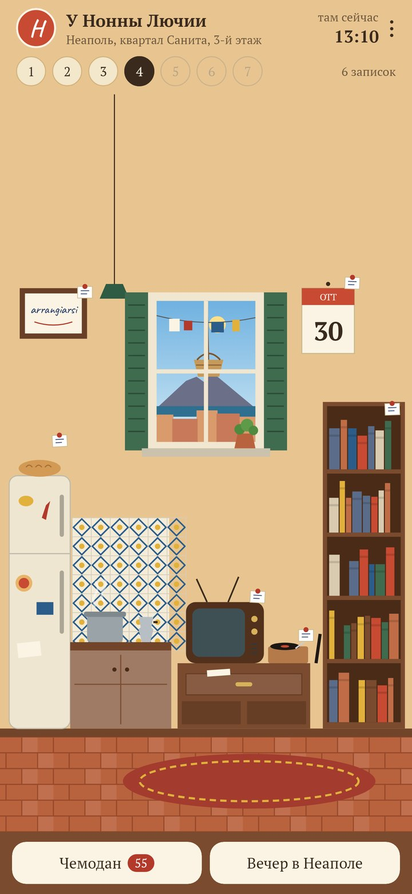
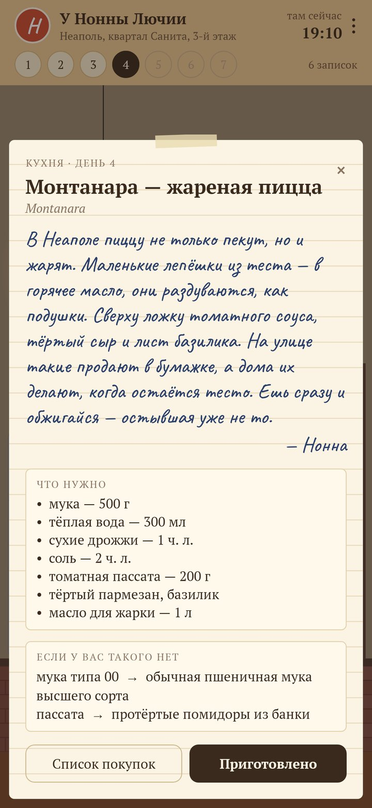
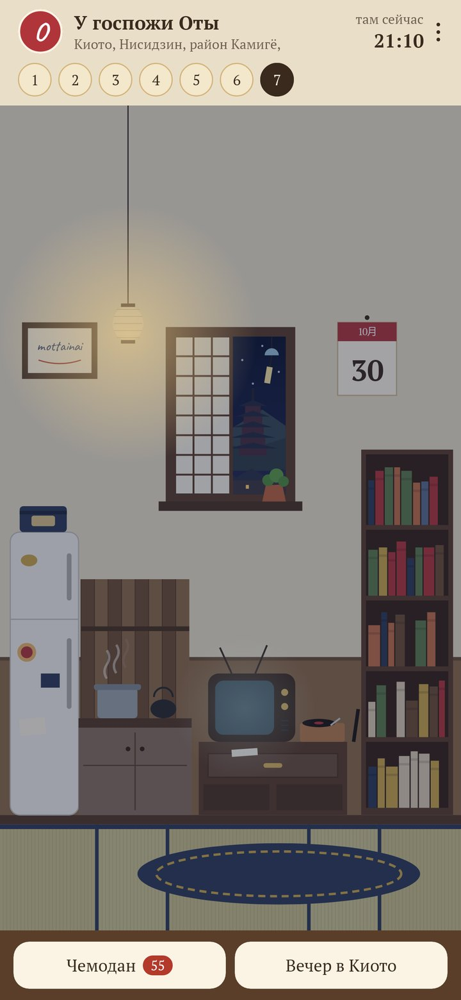

<div align="center">

# Ключ под ковриком

### Неделя в чужой квартире за границей — не выходя из дома.

*Ключ под ковриком. Хозяйка в Неаполе, Киото, Оахаке или Бергене уехала на неделю и разложила записки по всему дому: что приготовить вечером, какой фильм там знает каждый, какую пластинку поставить, какую книгу проходят в школе, правило дома, письмо в ящике стола. Каждое утро — новый день записок. Бесплатно, без рекламы и регистрации.*

[](https://github.com/bigdevwhale/undermat/actions/workflows/android.yml)


[](LICENSE)

[English](README.md) · **Русский** · [Изменения](CHANGELOG.md)

   

</div>

---

## Как это устроено

1. **Доска объявлений.** Двенадцать квартир сдаются на неделю: Неаполь, Киото, Оахака, Берген, Сеул, Лион, Тбилиси, Калькутта, Салвадор, Лиссабон, Голуэй, Стамбул. У каждой свой хозяин: неаполитанская бабушка, учительница на пенсии в старом киотском доме, судовой механик из Бергена, молодой дизайнер в комнатке на сеульской крыше…
2. **Ключ под ковриком.** Приподними коврик, прочитай записку, открой дверь.
3. **Записки во всех углах.** На кухне — рецепт на вечер и чем заменить то, чего нет в вашем магазине. У телевизора — фильм, который там знает каждый, и почему. Проигрыватель, книжная полка, магниты на холодильнике (настоящий факт и слово дня — телефон произнесёт его вслух), правило дома, непереводимое слово в рамке и письмо в ящике стола: за неделю из писем складывается целая история.
4. **То, что знает каждый местный, а не каждый турист.** Фильм, который показывают под каждый Новый год, песня с каждой свадьбы, книга из школьной программы, блюдо, которое готовит бабушка.
5. **Настоящее окно.** За окном город хозяина — в его местное время, с настоящими восходом, закатом и погодой.
6. **Соседи.** На второй, четвёртый и шестой день кто-нибудь заглядывает: соседка с пирожным, корзинка на верёвке за окном, мальчишка с лотерейным билетом — и за каждым свой обычай.
7. **Чемодан.** Приготовил, посмотрел, послушал, начал читать — и на чемодане новая наклейка в цветах города. На седьмой день оставляешь хозяину что-нибудь своё, кладёшь ключ под коврик, а неделя остаётся в «Моих неделях» — перечитать.
8. **Вечер в Лиссабоне.** Одна карточка на двоих или компанией: блюдо, пластинка, пока готовится, фильм после ужина, тост и три темы для разговора.

Хозяева придуманы, а все фильмы, пластинки, книги, блюда и праздники — настоящие.

## Приватность

Ни аккаунта, ни рекламы, ни аналитики. Всё хранится на телефоне. Единственный запрос в сеть — погода за окном хозяина: координаты города уходят в Open-Meteo (или в MET Norway, если Open-Meteo недоступен), больше ничего. «Где найти» открывает поиск в браузере или музыкальном приложении — само приложение ничего не показывает и не играет.

## Сборка

```bash
./gradlew testDebugUnitTest assembleDebug        # app.undermat.dev рядом с настоящей установкой
./gradlew assembleDebug -Pdemo                   # app.undermat.demo: четвёртый день недели в Неаполе
./gradlew testDebugUnitTest -Prender --tests '*RenderArt*'   # экраны в app/build/art
python tools/check_hosts.py                      # проверяет файлы хозяев по tools/CONTENT.md
```

Kotlin, Jetpack Compose, DataStore, WorkManager. Каждый хозяин — один JSON-файл в `app/src/main/assets/hosts` (оба языка, семь дней); как его писать — в `tools/CONTENT.md`. Квартиры нарисованы кодом (`ui/flat/Interior.kt`): одна комната, а у каждого города свой пол, плитка, окно, вид, лампа и одна вещь, которая могла оказаться только там.

## Лицензия

[MIT](LICENSE). Шрифты: PT Serif и Caveat (SIL OFL). Погода: [Open-Meteo.com](https://open-meteo.com) и [MET Norway](https://api.met.no) (CC BY 4.0).
